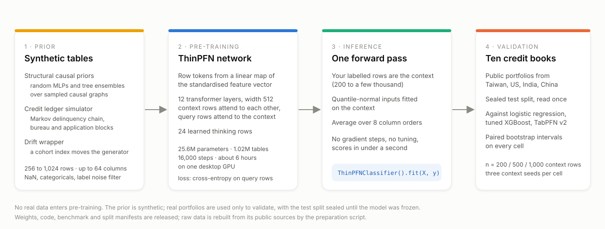
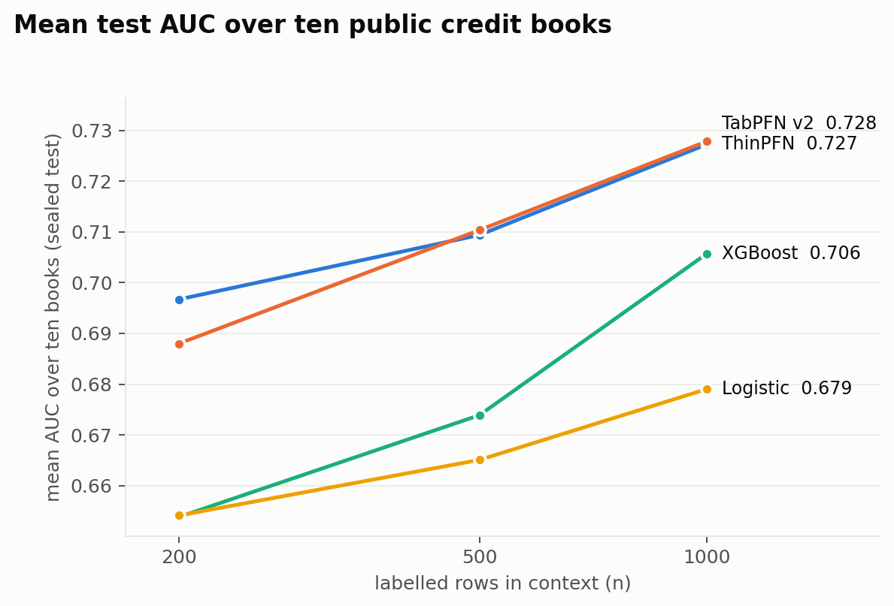
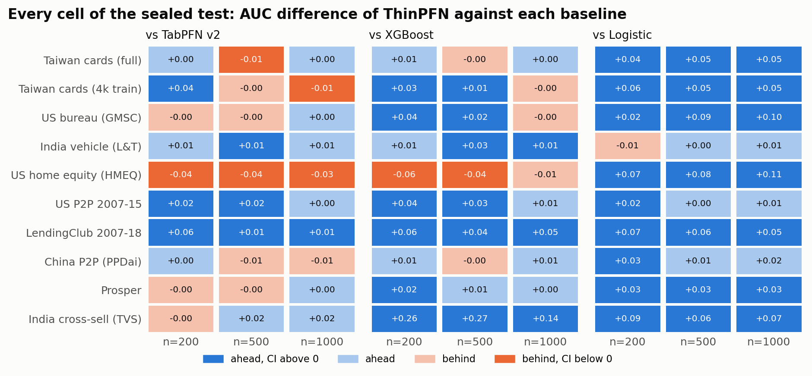
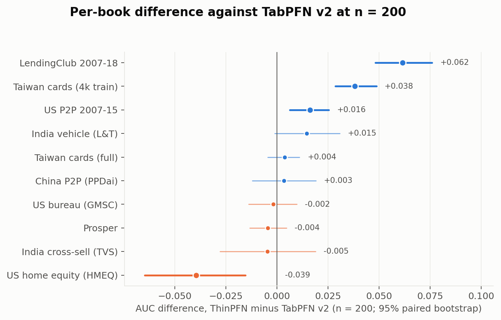
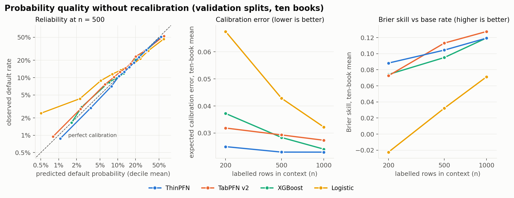
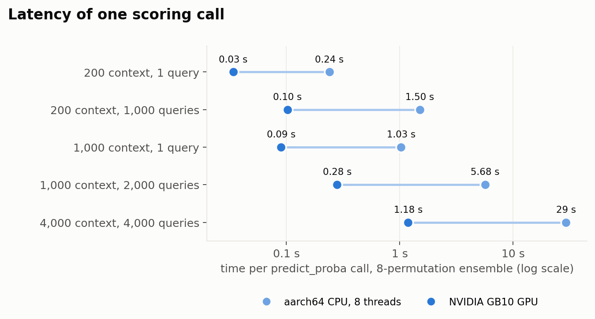
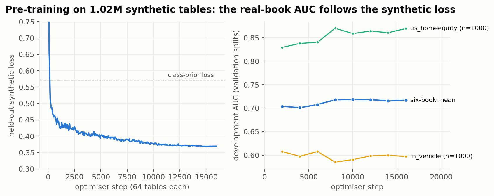
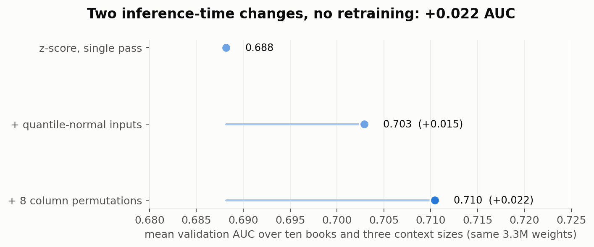
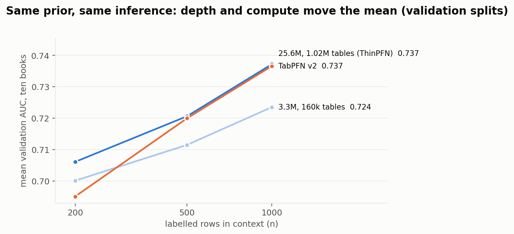

<p align="center">
  
</p>

<h1 align="center">ThinPFN</h1>

<p align="center"><b>A tabular foundation model you can train on one desktop GPU, validated on ten public credit portfolios.</b></p>

<p align="center">
  <a href="LICENSE"></a>
  
  
  
  
  <a href="https://github.com/maximer-v/thinpfn/actions/workflows/tests.yml"></a>
  <a href="https://github.com/maximer-v/thinpfn/releases"></a>
</p>

ThinPFN is a prior-fitted network: a transformer pre-trained on about a million synthetic tables so that, at use time, it
reads your labelled rows as context and scores new rows in one forward pass, with no training and no tuning. It is a
complete, small-scale instance of the idea behind tabular foundation models, built from scratch and documented end to
end: the synthetic prior, the network, the pre-training run, the inference recipe, and a sealed benchmark on ten public
credit books against logistic regression, tuned XGBoost and TabPFN v2.

On the sealed test split it ties TabPFN v2 on the ten-book mean, is ahead of it at the smallest context (n = 200), beats
tuned XGBoost in 23 of 30 cells, and beats logistic regression in 29 of 30. Its weak point is also documented: strongly
nonlinear books with strong signal, where boosted trees and the larger model stay ahead.

```python
from thinpfn import ThinPFNClassifier

clf = ThinPFNClassifier().fit(X_train, y_train)   # 200 to a few thousand labelled rows, NaN allowed
p = clf.predict_proba(X_new)[:, 1]
```

**Two meanings of "training".** `fit` here does no training: it stores the labelled rows as the context (like
k-nearest-neighbours' `fit`), and `predict_proba` scores new rows in one forward pass with the 25.6M weights unchanged.
The method is called `fit` only to honour the scikit-learn contract (pipelines, `cross_val_score`, `clone`). The one
training that ever happens is the pre-training of the weights on synthetic tables, done once by us in six GPU-hours and
reproducible with [`thinpfn/train.py`](thinpfn/train.py); a user never needs to run it.

## Contents

- [Why this exists](#why-this-exists)
- [Results on the sealed test](#results-on-the-sealed-test)
- [Are the scores usable as probabilities?](#are-the-scores-usable-as-probabilities)
- [Install and use](#install-and-use)
- [How it works](#how-it-works)
- [Reproduce the benchmark](#reproduce-the-benchmark)
- [Reproduce the model](#reproduce-the-model)
- [The ten books](#the-ten-books)
- [Limitations](#limitations)
- [Model card](#model-card)
- [Citation and licence](#citation-and-licence)

## Why this exists

In the credit, fraud and collections teams we have worked with, tabular data is scored with gradient-boosted trees,
one model per portfolio, retrained every time a batch of outcomes arrives. Tabular foundation models change the unit of
work: a network pre-trained once, on synthetic data, that treats a labelled table as a prompt. The labelled history is
the context, the new applications are the query, and the prediction is the posterior of a prior the network has
absorbed during pre-training. No gradient steps happen at decision time, so in principle a new segment, a new product or
a new country can be scored as soon as its first few hundred outcomes are known, and a confirmed outcome can enter the
next decision as soon as it is appended to the context (whether a lender's controls allow that cadence is a separate
question this repository does not answer).

The published models in this family (TabPFN, TabICL and their relatives) were pre-trained with budgets well beyond the
six GPU-hours used here and are released as weights. This repository asks a narrower question: how much of that capability can one person reproduce,
understand and own, with one desktop GPU and an evening of training, and does a prior that includes a credit ledger
simulator buy anything on real portfolios? The answer, measured rather than argued, is in the next section.

## Results on the sealed test

Protocol: for each book, the context is n stratified rows drawn from the training split (three seeds), the query is the
test split (up to 4,000 rows), which was read exactly once, after the model and the inference recipe were frozen. Every
baseline is fitted on the same contexts. Differences carry a 95% paired bootstrap interval over the query rows.

<p align="center"></p>

| n | ThinPFN | TabPFN v2 | XGBoost | Logistic |
|---|---|---|---|---|
| 200 | **0.697** | 0.688 | 0.654 | 0.654 |
| 500 | 0.709 | 0.710 | 0.674 | 0.665 |
| 1,000 | 0.727 | 0.728 | 0.706 | 0.679 |

| ThinPFN against | ahead | significantly ahead | significantly behind |
|---|---|---|---|
| TabPFN v2 | 17 / 30 cells | 7 | 5 |
| XGBoost (tuned on the context) | 23 / 30 | 15 | 2 |
| Logistic regression | 29 / 30 | 23 | 0 |

<p align="center"></p>

<p align="center"></p>

Three books carry the significant wins over TabPFN v2 at n = 200 (LendingClub +0.062, Taiwan cards with a small training
pool +0.038, US P2P +0.016); one book carries most of the losses (US home equity: −0.039, −0.038 and −0.028 against
TabPFN v2, −0.057 and −0.044 against XGBoost at n ≤ 500, the only book where XGBoost is significantly ahead). On the
three weak-signal books (India vehicle, China P2P, US P2P: no model reaches 0.66 AUC) ThinPFN is ahead of TabPFN v2 in 7
of 9 cells and of XGBoost in 8 of 9. The full table, with intervals, is in
[benchmark/results/sealed_test.txt](benchmark/results/sealed_test.txt).

Two caveats on the XGBoost comparison. On TVS (2% prevalence, four positives in a 200-row context) the small-context
XGBoost configuration collapses to a constant score (AUC 0.50) for every seed at n = 200 and one seed at n = 500; those
cells inflate the count. Excluding TVS, ThinPFN is ahead of XGBoost in 20 of 27 cells (12 significantly, 2 significantly
behind), with mean differences of +0.019, +0.009 and +0.008. And "tuned" means tuned on a held-out slice of the same
small context, which is the honest setting for the regime but not the ceiling of boosted trees with all the data.

## Are the scores usable as probabilities?

A credit score is used as a probability of default, so ranking is half the question. Version 1.1 adds a probability
study with the same contexts as the benchmark, scored on the **validation split** (the sealed test was read once, for
the AUC claims above, and is not read again; the validation splits were also used during development to choose the
inference recipe by AUC, so this is a descriptive study, not a second sealed test). No model is recalibrated: each one
outputs whatever its 200 to 1,000 context rows produce.

<p align="center"></p>

| n | model | KS | Brier skill | calibration error (ECE) | books worse than the base rate |
|---|---|---|---|---|---|
| 200 | ThinPFN | 0.315 | **+0.088** | **0.025** | 0 of 10 |
| 200 | TabPFN v2 | **0.321** | +0.073 | 0.032 | 2 of 10 |
| 200 | XGBoost | 0.259 | +0.074 | 0.037 | 4 of 10 |
| 200 | Logistic | 0.257 | −0.023 | 0.068 | 6 of 10 |
| 500 | ThinPFN | 0.339 | +0.104 | **0.023** | 0 of 10 |
| 500 | TabPFN v2 | **0.351** | **+0.113** | 0.029 | 0 of 10 |
| 500 | XGBoost | 0.297 | +0.095 | 0.028 | 0 of 10 |
| 500 | Logistic | 0.285 | +0.032 | 0.043 | 4 of 10 |
| 1,000 | ThinPFN | 0.365 | +0.119 | **0.023** | 0 of 10 |
| 1,000 | TabPFN v2 | **0.373** | **+0.128** | 0.027 | 0 of 10 |
| 1,000 | XGBoost | 0.340 | +0.120 | 0.024 | 0 of 10 |
| 1,000 | Logistic | 0.307 | +0.071 | 0.032 | 1 of 10 |

Means over the ten books. KS is the largest gap between the score distributions of defaulters and non-defaulters. Brier
skill is the improvement of the Brier score over always predicting the context's default rate (zero is no better than
the base rate). ECE is the expected calibration error over ten equal-count bins.

What the numbers say:

- **The probabilities are usable as they come out.** ThinPFN's calibration error is the lowest of the four models at
  every context size, lower than TabPFN v2 on nine of ten books at each n, and it is the only model that is never worse
  than the base-rate forecast on any book, even with 200 rows.
- **TabPFN v2 separates slightly better from n = 500.** It is ahead on mean KS at every n and on mean Brier skill at
  n = 500 and 1,000. Most of that Brier gap is one book, US home equity (+0.34 against +0.45 at n = 500), the same
  strong nonlinear book that carries the AUC losses; book by book, ThinPFN has the higher Brier skill in 20 of 30 cells.
- **The level follows the context.** ThinPFN's mean prediction is within about one point of the observed default rate
  on average (0.175 against 0.169), slightly high. Part of every model's calibration error here is not the model: on the
  out-of-time books the default rate moves between the context period and the scored period (LendingClub: 17% predicted,
  15% observed), and no model can see that from the context.
- **These are means without intervals.** The differences in calibration error are small and were not tested for
  significance.

Two practical consequences. If the labelled rows you pass as context were sampled at a different default rate than the
population you score (for example, oversampled defaulters), the probabilities follow the context, not the population,
and need an intercept correction. And if you have enough rows to hold some out, the classifier is a regular
scikit-learn estimator, so `CalibratedClassifierCV(ThinPFNClassifier(), method="sigmoid")` works as with any other model.
Per-book numbers are in [benchmark/results/calibration.csv](benchmark/results/calibration.csv).

## Install and use

To use the model, install it straight from GitHub; the weights ship inside the package:

```bash
pip install "git+https://github.com/maximer-v/thinpfn@v1.1.0"
```

To run the benchmark, the notebook or the pre-training, clone the repository (the split manifests, result files and
scripts live outside the package):

```bash
git clone https://github.com/maximer-v/thinpfn && cd thinpfn
pip install -e .                 # torch, numpy, pandas, scipy, scikit-learn, safetensors, pyarrow
pip install -e ".[benchmark]"    # adds xgboost, tabpfn, matplotlib for the benchmark scripts
```

The released weights (`thinpfn/weights/thinpfn_v1.safetensors`, 51 MB, fp16) ship in the repository and load on CPU or GPU.
A GPU is not required.

```python
import pandas as pd
from thinpfn import ThinPFNClassifier

train = pd.read_csv("my_portfolio_labelled.csv")       # a few hundred to a few thousand rows
new = pd.read_csv("my_applications.csv")
features = [c for c in train.columns if c != "default"]

clf = ThinPFNClassifier()                                # defaults: qnorm inputs, 8 column permutations, GPU if available
clf.fit(train[features], train["default"])               # stores the context; no training happens here
scores = clf.predict_proba(new[features])[:, 1]          # probability of the positive class
```

What the front end does for you:

- numeric columns are quantile-normalised on the context (the released recipe; `preprocess="z"` gives the plain z-score);
- `object`, `category` and `bool` columns are ordinal-encoded on the context; unseen categories become NaN;
- NaN is a first-class input (the network sees a missingness indicator per cell);
- the log-odds are averaged over `n_perm=8` random column orders; set `n_perm=0` for a single pass;
- contexts above `max_context=4096` rows are stratified-subsampled; at most 64 features are accepted.

`ThinPFNClassifier.decision_function` returns log-odds, `predict` thresholds them at zero. The model object itself is
`thinpfn.load_pretrained()`; its `predict(X_ctx, y_ctx, X_query, ...)` is the lower-level entry point.

### Latency

Time of one `predict_proba` call (20 numeric features, median of three calls after a warm-up), measured with
[benchmark/latency.py](benchmark/latency.py) on an Arm CPU limited to 8 threads and on one desktop GPU (NVIDIA GB10):

| context rows | query rows | CPU, default (8 orders) | CPU, `n_perm=0` | GPU, default (8 orders) | GPU, `n_perm=0` |
|---|---|---|---|---|---|
| 200 | 1 | 0.24 s | 0.03 s | 0.03 s | 0.006 s |
| 200 | 1,000 | 1.5 s | 0.18 s | 0.10 s | 0.016 s |
| 1,000 | 1 | 1.0 s | 0.14 s | 0.09 s | 0.015 s |
| 1,000 | 2,000 | 5.7 s | 0.75 s | 0.28 s | 0.04 s |
| 4,000 | 4,000 | 29 s | 3.6 s | 1.2 s | 0.17 s |

<p align="center"></p>

Every call reads the context again (nothing is cached between calls), so scoring one application costs about as much
as the context alone: batch the queries when you can. The eight column orders multiply the cost by eight; `n_perm=0`
gives a single pass, and gives up what the ensemble adds: 0.006 to 0.010 AUC in the inference study below (measured on
the smaller development model).

### Notebook

[notebooks/thinpfn_walkthrough.ipynb](notebooks/thinpfn_walkthrough.ipynb) runs the model on one public book, compares it
with logistic regression and XGBoost at three context sizes, shows the effect of the inference recipe, and draws a table
from the synthetic prior so you can see what the network was trained on.

## How it works

**The prior.** Training data is generated, never collected. Each table comes from one of three generators: a random
multilayer perceptron over a sampled causal graph, a random tree ensemble over a sampled causal graph (both with a
continuous target thresholded to a binary label at a sampled prevalence), or a credit ledger simulator that draws a
product, a portfolio prevalence, an observation window and a default horizon, simulates each borrower's monthly
delinquency state with a Markov chain driven by latent risk, and emits application, bureau and ledger columns with the
label defined on the horizon. A drift wrapper gives a share of tables a cohort index along which the generating
function moves. Every table then passes the same contract: a random context share, NaN injection, nuisance and
collinear columns, standardisation on the context rows, and a learnability filter that drops tables a tree ensemble
finds either trivial or unlearnable. The mixture weights of the released model are 0.40 MLP, 0.20 tree, 0.30 ledger,
0.10 drifting variants. Nothing from any real portfolio enters pre-training.

**The network.** Each row is a token: a linear map of its standardised feature vector, NaN indicators and categorical
flags, plus a label embedding on context rows (an "unknown label" embedding on query rows) and a cohort embedding.
Twenty-four learned "thinking" rows are prepended. A 12-layer transformer of width 512 runs over the rows with a mask
that lets context rows attend to each other and query rows attend only to the context, so a query row's score never
depends on which other query rows are in the batch. The loss is the cross-entropy on query rows. 25.6M parameters.

**Pre-training.** 16,000 AdamW steps of 64 tables each (1.02M tables, 256 to 1,024 rows, up to 64 columns), learning
rate 5e-4 with warm-up and cosine decay, bf16 autocast, tables generated on the fly by CPU workers. About six hours on
one desktop GPU; the run is bound by table generation, not by the network. The last six snapshots are averaged.

<p align="center"></p>

**Inference.** Two choices made after pre-training, on validation splits, are worth 0.022 AUC together with the same
weights: a quantile-normal transform of the numeric inputs fitted on the context (real credit columns are heavy-tailed
and discrete; the z-score the prior was standardised with squashes them, and the prior's own inputs are close to
Gaussian), and averaging over eight random column orders (the row embedding is slot-wise, so the network is not
permutation-invariant and the orders act as an ensemble).

<p align="center"></p>

**What moved the needle and what did not.** Within a run, the real-book AUC tracked the synthetic held-out loss, so
fitting the prior better was the lever; a 3.3M model on 160k tables and the released 25.6M model on 1.02M tables differ
by about one point on the ten-book mean (depth and training budget changed together in that comparison). Making the
synthetic stream statistically resemble real books (discretised columns, label noise, realistic marginals) did not help
at equal compute. The remaining deficit to TabPFN v2 is concentrated on books with strong, nonlinear signal. The
development experiments behind these statements are summarised in the paper; the released result files are the sealed
test, the probability study, the latency table, the inference study and the size comparison.

<p align="center"></p>

## Reproduce the benchmark

The repository ships no data. The preparation script downloads each book from its public source (atomically, then
verifies the file's SHA-256 against the benchmark's), rebuilds the exact feature view, and joins the shipped split
manifests (`benchmark/splits/`, raw row key to split). With matching sources the tables equal the benchmark's row for
row; if a source has changed since, the hash warns and the join fails where rows moved. LendingClub is a 1.7 GB
download; everything else is small. The benchmark scripts expect a repository checkout (the manifests are not part of
the installed package).

```bash
python -m thinpfn.data.books prepare                 # all ten books into data/books/*.parquet
python benchmark/run_benchmark.py                    # validation split, ThinPFN vs logistic / XGBoost / TabPFN v2
python benchmark/run_benchmark.py --split test --sealed   # the sealed protocol (read the note below first)
python benchmark/run_calibration.py                  # probability quality on the validation split (KS, Brier, ECE)
python benchmark/latency.py                          # latency table, CPU and GPU if present (needs no data)
python benchmark/make_figures.py                     # the figures in this README from benchmark/results
```

The test split is guarded in code: `books.load(name, "test")` raises unless `sealed_ok=True`, and the benchmark script
needs `--sealed` with `--split test`. The released numbers come from one such run, made after the weights and the
inference recipe were frozen; re-running it with a changed model is a new experiment, and should be reported as one.

## Reproduce the model

```bash
PYTORCH_CUDA_ALLOC_CONF=expandable_segments:True \
python -m thinpfn.train --run thinpfn_v1 --config thinpfn_v1 --mixture default \
    --steps 16000 --batch-tables 64 --lr 5e-4 --warmup 400 --workers 12
```

`thinpfn/train.py` is the trainer that produced the released weights: prior workers, cosine schedule, fixed held-out
synthetic batch, resumable checkpoints every 50 steps, snapshot averaging, optional development AUC on prepared books
(`--dev-books us_bureau,us_homeequity`, off by default so a weights-only checkout can train), and two guards that matter
on a desktop machine (a thermal pause and a host-memory exit). `--seed` fixes the initialisation and the prior streams;
a resumed run restarts the prior streams, so it does not see the same tables as an uninterrupted one (the released
weights are one uninterrupted run). Smaller configurations (`--config small`, 3.3M parameters, about 45 minutes for
2,500 steps) are useful for ablations of the prior.

## The ten books

| book | origin | rows used | features | prevalence | licence at source |
|---|---|---|---|---|---|
| uci_full | UCI 350, Taiwan credit cards, 2005 | 30,000 | 23 | 22% | CC BY 4.0 |
| tw_cards | same table, 4,000 training rows | 16,000 | 23 | 22% | CC BY 4.0 |
| us_bureau | Give Me Some Credit (OpenML 46929) | 9,335 | 10 | 6% | Kaggle competition rules |
| in_vehicle | L&T vehicle loans, India (OpenML 46430) | 9,335 | 19 | 22% | hackathon data, OpenML Public |
| us_homeequity | HMEQ home equity (OpenML 43337) | 5,960 | 12 | 20% | CC0 as declared |
| us_p2p | LendingClub 2007 to 2015 (OpenML 43729) | 7,832 | 13 | 16% | CC0 |
| lending_club | LendingClub 2007 to 2015 vintages (matured by 2018), out-of-time splits | 642,138 | 28 | 15% | CC0 as declared by the re-host |
| ppdai | PPDai, China (figshare) | 55,596 | 29 | 13% | CC BY 4.0 |
| prosper | Prosper 2005 to 2014, matured loans, out-of-time splits | 38,907 | 36 | 15 to 38% | unknown: evaluation only |
| tvs | TVS Credit cross-sell, India (OpenML 43743) | 119,528 | 29 | 2% | CC0 as declared |

Sources, labels, split rules and caveats are in [thinpfn/data/books.py](thinpfn/data/books.py). Two pairs share an
origin (uci_full and tw_cards share the same 4,500 test rows; lending_club and us_p2p are different extracts of
LendingClub), so there are eight source datasets, not ten independent lenders. The lending_club book keeps only loans
that had matured by the end of 2018, so its vintages end in 2015. The two Taiwan books are behavioural scoring (six
months of repayment history, label the next month); the others are origination-time fields, with PPDai's 29 fields
taken as released. Ordinal codes for string columns are assigned on the whole source table (label-free, sorted unique
values), a transductive step that the sealed test inherits. TVS contains many identical feature rows across splits (1,919
test rows match a training row exactly); the bootstrap unit is the row everywhere. Licences declared by a re-host do not
override the original rights holder's terms; check them before any use beyond research.

Source records (accessed 2026-11-09; exact URLs and SHA-256 of every raw file are in `books.py`):
[Taiwan credit cards, UCI 350](https://doi.org/10.24432/C55S3H) (Yeh and Lien, 2009) ·
[Give Me Some Credit, Kaggle 2011](https://www.kaggle.com/c/GiveMeSomeCredit) via [OpenML 46929](https://www.openml.org/d/46929) ·
[L&T vehicle loans, LTFS FinHack 2019](https://datahack.analyticsvidhya.com/contest/ltfs-datascience-finhack-an-online-hackathon/) via [OpenML 46430](https://www.openml.org/d/46430) ·
HMEQ from Baesens, Roesch and Scheule, *Credit Risk Analytics* (Wiley, 2016) via [OpenML 43337](https://www.openml.org/d/43337) ·
LendingClub public loan files via [OpenML 43729](https://www.openml.org/d/43729) and the [Hugging Face mirror](https://huggingface.co/datasets/codesignal/lending-club-loan-accepted) ·
[PPDaiData, figshare](https://doi.org/10.6084/m9.figshare.13573856) (He, 2021) ·
[Prosper listings, Udacity copy](https://s3.amazonaws.com/udacity-hosted-downloads/ud651/prosperLoanData.csv) ·
[TVS Credit, OpenML 43743](https://www.openml.org/d/43743).

## Limitations

- **Strong nonlinear signal.** On the home equity book (boosting beats logistic by 13 points) ThinPFN trails TabPFN v2
  by 3 to 4 points at every n and XGBoost by 4 to 6 points at n ≤ 500. The development evidence (gains from depth landed
  on exactly these books) points to network capacity rather than the prior, but the size comparison changed depth and
  training budget together, so this is the working hypothesis, not an established cause.
- **Context size.** Pre-trained on tables of at most 1,024 rows; above a few thousand context rows it stops improving,
  and a tuned boosted model with the full data will be better. The model is for the small-sample regime.
- **Binary labels, at most 64 features, numeric inputs.** Multiclass, regression, text and relational inputs are out
  of scope; wide tables need a feature selection step first.
- **Development selection.** The inference recipe and the model depth were chosen on validation splits that were read
  many times. The sealed test was read once; the significant wins over TabPFN v2 at n = 200 shrank from five books on
  validation to three on test, which is the expected size of that selection effect.
- **Probabilities follow the context.** The predicted level is anchored on the default rate of the context rows. A
  context sampled at a different rate than the scored population, or an out-of-time shift in the default rate, moves
  the calibration and needs a correction outside the model. The probability study uses validation splits, not the
  sealed test.
- **One seed, one run.** The released weights are one pre-training run; the variance across pre-training seeds has
  not been measured.

## Model card

| | |
|---|---|
| Model | ThinPFN v1, 25.6M parameters, 12 layers, width 512, 24 thinking rows |
| Task | binary classification of tabular rows from a labelled context (in-context learning) |
| Training data | synthetic only: structural causal priors and a credit ledger simulator, 1.02M tables |
| Real data | used only for validation (development splits) and the sealed test; never for training |
| Intended use | research and non-commercial scoring of small labelled tables, 200 to a few thousand rows, up to 64 features |
| Not intended | commercial use (licence), automated decisions about people without human review and fairness assessment |
| Evaluation | ten public credit books, sealed test, against logistic, XGBoost, TabPFN v2 (this README) |
| Probability quality | no recalibration: mean calibration error 0.023 to 0.025, Brier skill +0.09 to +0.12 (validation splits) |
| Compute | about 6 GPU-hours of pre-training on one desktop GPU; scoring runs on CPU (latency table above) |
| Weights | `thinpfn/weights/thinpfn_v1.safetensors` (fp16), configuration in `thinpfn/weights/thinpfn_v1.json` |

## Citation and licence

Code, weights, benchmark and paper are released under the
[Creative Commons Attribution-NonCommercial 4.0](LICENSE) licence: use, share and adapt them for research and other
non-commercial purposes with attribution; commercial use needs a separate agreement. The datasets keep their own terms.

The paper is in [paper/thinpfn.pdf](paper/thinpfn.pdf).

```bibtex
@software{mancilla2026thinpfn,
  author  = {Mancilla Montero, Javier},
  title   = {ThinPFN: a prior-fitted network for small-sample credit scoring},
  year    = {2026},
  url     = {https://github.com/maximer-v/thinpfn},
  license = {CC-BY-NC-4.0}
}
```

ThinPFN is a personal research project by Javier Mancilla Montero (SquareOne Labs). The design follows the published
TabPFN and TabICL papers; no code from those projects is used.
